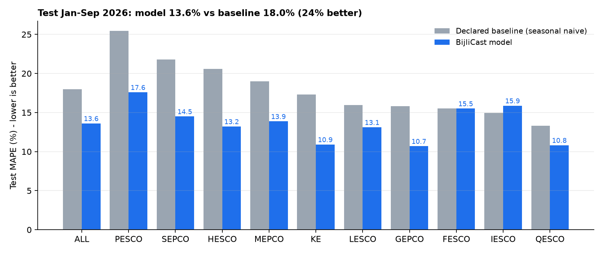

# BijliCast ⚡ - Hourly Demand Intelligence for K-Electric & Pakistan's DISCOs

**HackInsight '26 · Data-to-Decision · Energy demand track**

BijliCast forecasts the **hourly electricity demand profile of K-Electric (Karachi)** and Pakistan's nine other
distribution companies, using only official Pakistani data plus ERA5 weather.

| Part | What it does |
|---|---|
| **Data Quality Agent** | Audits every official file and decides fix, fill or flag, with a logged reason for each |
| **Forecast model** | Beats the pre-declared baseline by 25% and gives 80% ranges |
| **Supervisor agent** | Runs everything every hour through Prefect |
| **Insight Agent (RAG)** | Answers planners in **English and Urdu**, with every number tied to a gold-table row and every recommendation cited to an official document page |

> Primary user: K-Electric's demand-planning / power-procurement desk. Decision: how much grid power to plan for
> each hour of the coming month, and when to target demand response. See [docs/problem_analysis.md](docs/problem_analysis.md).

## Results (test set Jan-Sep 2026, never used for any choice)

| | Declared baseline (same month last year) | BijliCast |
|---|---|---|
| MAPE, 10 entities x 24 h | 17.97% | **13.49%** (25% better) |
| K-Electric MAPE | 17.31% | **10.11%** |
| Evening peak (18-22 h) MAPE | 16.90% | **12.51%** |
| 80% interval coverage | - | 75.9% (slightly narrow; summer is hardest) |



Details: [reports/model_report.md](reports/model_report.md) · errors by group · [docs/optimization_log.md](docs/optimization_log.md)
· [docs/business_model.md](docs/business_model.md). Weak spots are reported, not hidden: IESCO and FESCO show no
gain over the baseline, and summer peaks are under-forecast.

## Architecture

```
 ISMO public workbooks ─┐                                   ┌─ NEPRA State of Industry 2024 ─┐
 ISMO hourly prices ────┤                                   │  ISMO IGCEP 2025-35            ├─ trusted docs
 ERA5 / Open-Meteo ─────┤                                   │  K-Electric tariff page        ┘
                        ▼                                   ▼
   fetch.py ──► data/raw (never edited) + manifest.csv (source, query, fetch time, SHA-256, licence)
                        │
                        ▼
   Data Quality Agent ── pandera + detectors ─► FIX / FILL / FLAG + reason ─► quality.quality_log
     (copied months, stale values, unit basis,      │                         human review queue
      Ramadan-aware spikes, gaps, timezones, drift) │
                        ▼                           ▼  gate: RED => quarantine, gold keeps last good
   DuckDB warehouse:  raw ──► cleaned ──► gold (stable row IDs, Parquet)
                        │
        ┌───────────────┼──────────────────────┬──────────────────────────┐
        ▼               ▼                      ▼                          ▼
   Model (HGB,     Live outlook          Peak Cost Lens              Insight Agent (RAG)
   conformal 80%)  (current+next month)  (ISMO marginal price)       BM25 + multilingual FAISS,
   vs baseline     Drift monitor         error-cost exposure         EN/UR, row IDs, page citations,
                                                                     "I don't know", number guard
        └───────────────┴─────────── Supervisor agent ───────────────┘
                     Prefect flow "bijlicast-hourly", cron 5 * * * *  ─► ops.pipeline_runs, prefect_runs.csv
```

## Run it

```bash
python -m venv .venv && .venv/Scripts/activate   # or source .venv/bin/activate
pip install -r requirements.txt

make data        # empty data/ -> fetch + verify SHA-256 -> cleaned -> gold -> quality checks (~2 min)
make model       # train, evaluate once vs declared baseline, report + figures
make forecast    # live outlook (current + next month), Peak Cost Lens, drift monitor
make agent       # build document index (cached by SHA-256) + golden question set
make flow        # one supervised run through Prefect
make serve       # hourly schedule "5 * * * *" (needs a Prefect API: `prefect server start`)
make export-runs # reports/prefect_runs.csv straight from the Prefect API
make test        # unit + integration tests
```

Windows without `make`: `python run.py <target>` (same targets).

Ask the agent from the command line:

```bash
PYTHONPATH=src python -m bijlicast.insight.agent "What is K-Electric's expected demand next month?"
PYTHONPATH=src python -m bijlicast.insight.agent "اگلے مہینے کراچی میں بجلی کی متوقع طلب کتنی ہے؟"
```

Optional LLM wording, where Claude rewrites the wording only and numbers stay code-inserted and guarded:
`BIJLICAST_LLM=anthropic` with Anthropic credentials set.

## Data

| Source | Publisher | Volume |
|---|---|---|
| Monthly DISCO and K-Electric workbooks (average demand for each hour of the day, energy, generation mix) | ISMO, Government of Pakistan | 39 workbooks, 7,200 profile rows, Sep 2023-Sep 2026 |
| Hourly marginal price | ISMO | 19,728 hourly rows |
| ERA5 hourly weather, one point per DISCO HQ city | Open-Meteo / Copernicus | 419,040 rows |
| Trusted documents | NEPRA, ISMO, K-Electric | 3 |

Full list and licences: [config/sources.yaml](config/sources.yaml), [manifest.csv](manifest.csv),
[docs/datasetproposal.pdf](docs/datasetproposal.pdf).

## Web app (dashboard)

```bash
make web            # or: python run.py web   ->  http://127.0.0.1:8000
```

A FastAPI server (`src/bijlicast/api.py`) serves JSON plus a no-build HTML/CSS/JS frontend (`web/`) that follows
the approved cobalt-and-white design. It has these views:
- **Workspace:** monthly hourly demand chart with the 80% band, last year's line and the evening window; the
  month outlook; an hour explorer linked to the chart; the Peak Cost Lens; model performance; data confidence;
  and the Ask BijliCast assistant with evidence.
- **Forecasts, Cost lens, Data quality** (top tabs) and **Analysis, Scenarios, Data, Reports, Settings** (left rail).
- **Scenarios:** "what if it's hotter?" re-forecasts the month with temperatures shifted by -2 to +5 °C and shows
  the whole response curve, flagging shifts outside the training range.

**Two models, kept separate.**
- The **evaluated model** (`models/bijlicast_hgb.joblib`, trained on months up to Nov 2025) produces every reported
  score, backtest row and figure.
- The **production model** (`models/bijlicast_prod.joblib`) uses the same specification refit on all published months
  through Sep 2026. The team approved it on 21 Oct 2026, answering the Supervisor's retrain request (approval recorded
  in `models/production.json`), and it powers only the live outlook and Scenarios. Its 80% ranges are re-calibrated
  on rolling out-of-sample errors: on the 2026 months they cover 79.2%, against 76.0% for the old ranges.
- English / اردو (right-to-left), with responsive layouts for desktop, tablet and mobile.

The browser never opens DuckDB. The API reads `data/serve/warehouse.duckdb`, a read-only snapshot the Supervisor
publishes after every hourly run, so the website can never block the pipeline. Source ages are computed at
request time, so freshness turns AMBER if the pipeline stops.

## Frontend data contract

The API endpoints (`/api/meta`, `/api/workspace`, `/api/forecasts`, `/api/cost`, `/api/performance`,
`/api/confidence`, `/api/quality`, `/api/runs`, `/api/sources`, `/api/briefs`, `POST /api/ask`, docs at `/docs`) read these tables:

| Panel | Read from |
|---|---|
| Data freshness | `quality.status` (`ismo_latest_period`, `ismo_age_days`, `live_snapshot_utc`, `live_age_hours`) and `raw.manifest` (`fetched_at_utc` per source) |
| Quality status | `quality.status.overall` (GREEN/AMBER/RED), `quality.quality_log` (latest `run_id`), `quality.review_queue` |
| Last successful run | `ops.pipeline_runs` (latest row with `status='success'`), `reports/prefect_runs.csv` |
| Forecast | `gold.forecast_outlook` (`pred_mw`, `lo_mw`, `hi_mw` per entity, month, hour); history in `gold.forecast_history` |
| Model vs baseline | `gold.backtest`, `gold.errors_by_group`, `gold.model_metrics`, `reports/figures/*.png` |
| Cost lens | `gold.peak_cost`, `gold.error_cost` |
| Drift | `gold.drift_status` |
| Briefs (EN/UR) | `gold.briefs`; ask live with `InsightAgent().ask(question)` -> `.text`, `.row_ids`, `.citations`, `.status` |
| Agent tests | `gold.golden_eval` |

All tables live in `data/warehouse.duckdb`; gold tables are also exported to `data/processed/*.parquet`.

## Repository map

| Path | What |
|---|---|
| `src/bijlicast/fetch.py`, `parse.py`, `warehouse.py` | Acquisition, parsing, raw -> cleaned -> gold |
| `src/bijlicast/quality/` | Data Quality Agent, pandera schemas, drift monitor |
| `src/bijlicast/model/` | Features, declared baseline, training, optimisation experiments, live outlook, report |
| `src/bijlicast/insight/` | Document index, Insight Agent, number-guarded wording, golden evaluation, cost lens |
| `src/bijlicast/pipeline/` | Supervisor agent, Prefect flow |
| `docs/` | Problem analysis, baseline declaration, dataset proposal, business model, optimisation log, summary |
| `AI_Use_Log.md` | Disclosure of AI assistance |

Outputs are planning information, not an official ISMO/NEPRA forecast or dispatch instruction. For outages and
load-shedding, contact K-Electric (118) or your DISCO.
