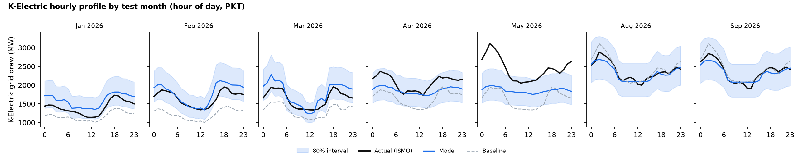
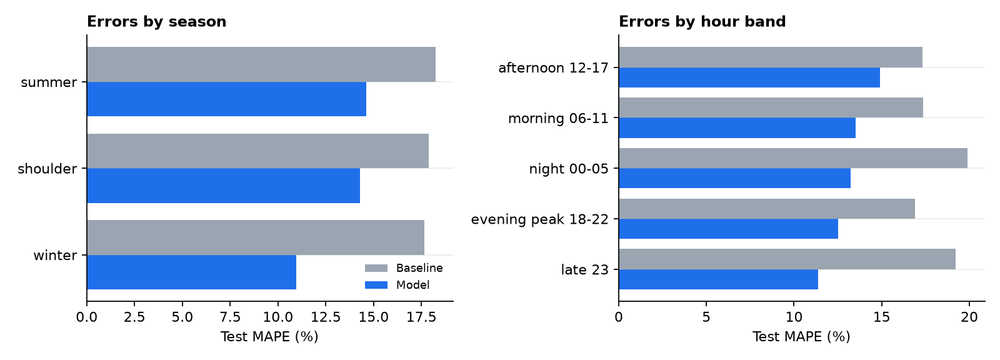

# Model Report (generated from gold tables)

Trained 2026-10-20T17:29:33Z · seed 42 · test months 2026-01, 2026-02, 2026-03, 2026-04, 2026-05, 2026-08, 2026-09 (Jun-Jul 2026 not published by ISMO).

## Headline (test set, evaluated once, ex-ante weather = climatology)

| | Declared baseline | BijliCast model |
|---|---|---|
| MAPE, all 10 entities x 24 h | 17.97% | **13.49%** (25% better) |
| K-Electric MAPE | 17.31% | **10.11%** |
| K-Electric MAE | 338 MW | **204 MW** |
| Evening peak 18-22 h MAPE | 16.90% | **12.51%** |
| 80% interval coverage | - | 75.9% (mean width 42% of forecast) |
| Same model, actual (ex-post) weather | - | 12.35% (upper bound if weather were known) |

Declared success criterion (>= 10% lower MAPE and K-Electric better): **met**.

## Errors by group

| entity | rows | baseline MAPE | model MAPE | change | 80% coverage | bias |
|---|---|---|---|---|---|---|
| PESCO | 168 | 25.4% | 17.8% | -30% | 66% | +1.6% |
| IESCO | 168 | 14.9% | 15.7% | +5% | 66% | -8.4% |
| FESCO | 168 | 15.5% | 15.3% | -1% | 71% | -1.6% |
| SEPCO | 168 | 21.8% | 14.1% | -35% | 78% | -5.2% |
| MEPCO | 168 | 19.0% | 14.0% | -26% | 74% | -6.2% |
| LESCO | 168 | 16.0% | 13.5% | -16% | 70% | -5.5% |
| HESCO | 168 | 20.6% | 13.0% | -37% | 82% | +4.2% |
| QESCO | 168 | 13.3% | 10.7% | -20% | 82% | -3.0% |
| GEPCO | 168 | 15.8% | 10.6% | -33% | 79% | -8.2% |
| KE | 168 | 17.3% | 10.1% | -42% | 90% | -2.9% |

| province | rows | baseline MAPE | model MAPE | change | 80% coverage | bias |
|---|---|---|---|---|---|---|
| Khyber Pakhtunkhwa | 168 | 25.4% | 17.8% | -30% | 66% | +1.6% |
| ICT/Punjab | 168 | 14.9% | 15.7% | +5% | 66% | -8.4% |
| Punjab | 672 | 16.6% | 13.4% | -19% | 74% | -5.2% |
| Sindh | 504 | 19.9% | 12.4% | -38% | 84% | -1.7% |
| Balochistan | 168 | 13.3% | 10.7% | -20% | 82% | -3.0% |

| season | rows | baseline MAPE | model MAPE | change | 80% coverage | bias |
|---|---|---|---|---|---|---|
| summer | 720 | 18.2% | 14.6% | -20% | 65% | -11.3% |
| shoulder | 480 | 17.9% | 14.3% | -20% | 79% | +7.7% |
| winter | 480 | 17.6% | 11.0% | -38% | 88% | +0.7% |

| hour band | rows | baseline MAPE | model MAPE | change | 80% coverage | bias |
|---|---|---|---|---|---|---|
| afternoon 12-17 | 420 | 17.3% | 14.9% | -14% | 72% | -0.2% |
| morning 06-11 | 420 | 17.4% | 13.5% | -22% | 75% | -1.6% |
| night 00-05 | 420 | 19.9% | 13.2% | -33% | 75% | -8.2% |
| evening peak 18-22 | 350 | 16.9% | 12.5% | -26% | 80% | -4.8% |
| late 23 | 70 | 19.2% | 11.4% | -41% | 84% | -8.1% |

## Where the model is weakest and what a user should do

* **Weakest entity: PESCO** (17.8% MAPE). Its profile has
  Ramadan sehri spikes and recurring scheduled-load-management jumps (see quality log `DQ-ISMO-SPIKE`).
* **No gain over the baseline for: IESCO.** For these, planners should keep the
  seasonal-naive figure and use our interval as a range check.
* **Summer is hardest:** the model under-forecasts summer months (negative bias) and interval coverage falls below 80%.
  Treat summer evening-peak forecasts as a floor, not a ceiling.
* Intervals cover 76% of test values against an 80% target: slightly too narrow, mainly in summer.

## Method

* Target: log(demand / latest published level); prediction = level x exp(model). Handles K-Electric's 2025 step
  change in grid draw without extrapolating trends.
* Model: scikit-learn HistGradientBoostingRegressor {'learning_rate': 0.05, 'max_leaf_nodes': 15, 'l2_regularization': 1.0, 'max_iter': 150} chosen on validation months Oct-Dec 2025
  (validation MAPE 12.80%).
* Leakage guards: demand lags >= 2 months (ISMO publication lag); climatology uses only earlier years; final model
  trained on targets <= Nov 2025 (all ISMO had published by 1 Jan 2026); test touched once.
* Intervals: split-conformal on 1440 rolling-origin out-of-sample residuals,
  log-quantiles -0.214 / 0.208.
